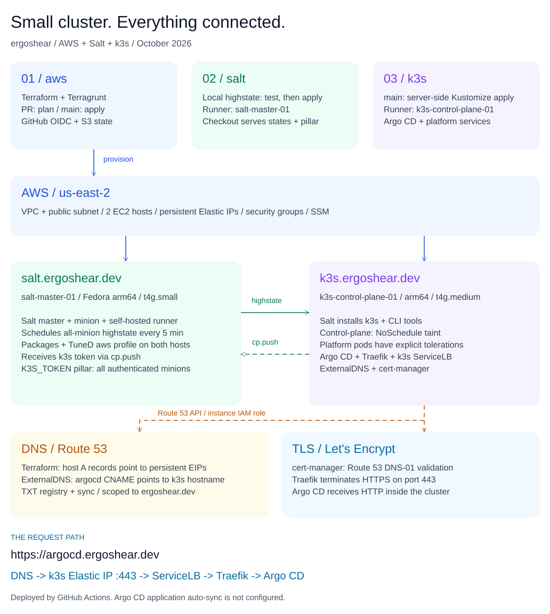

# Welcome to ergoshear

Small cluster. Big "I can automate that" energy.

This is where cloud infrastructure, configuration management, Kubernetes, and
bare-metal GPU inference meet, compare YAML, and agree that the next manual
step should probably be code.

## Three repos, one tiny platform

| Repo | Job description |
| --- | --- |
| [aws](https://github.com/ergoshear/aws) | Builds the neighborhood: Terraform, Terragrunt, EC2, persistent Elastic IPs, networking, and Route 53. |
| [salt](https://github.com/ergoshear/salt) | Keeps the machines in line: Tailscale, Salt, TuneD, k3s across the control plane and workers, and rootless Podman/Toolbx `llama-server` routers across bare-metal GPU nodes. Highstate checks in every five minutes. |
| [k3s](https://github.com/ergoshear/k3s) | Runs the platform: Argo CD, Traefik, ExternalDNS, and cert-manager, with automated GitOps sync and AWS IAM Identity Center SSO configured. |

## The map (not a treasure map, but there is YAML)

[Open the full-size diagram](assets/cluster-architecture.svg) ·
[Download the editable Excalidraw source](assets/cluster-architecture.excalidraw)

Architecture snapshot: October 19, 2026. The repositories are the source of truth.

## How the gears turn

- **Infrastructure:** pull requests get a Terraform plan; pushes to `main` apply
  the live environment through GitHub OIDC.
- **Machines:** Salt tests the local highstate before applying it, manages
  Tailscale connectivity, routes cloud nodes to `aws` TuneD profiles and GPU
  nodes to `throughput-performance`, and verifies cross-worker pod traffic,
  cluster DNS, and worker metrics after deployment. The master schedules
  highstate across its minions every five minutes.
- **Cluster:** GitHub Actions bootstraps Argo CD and applies its Application;
  Argo CD then auto-syncs the repository with pruning and self-healing enabled.
  Salt's deployment checks validate the Tailscale-backed worker network.
- **The front door:** ExternalDNS handles Route 53, cert-manager handles
  Let's Encrypt certificates, and Traefik gets HTTPS to Argo CD.
- **Identity:** Argo CD is configured for AWS IAM Identity Center SSO through
  Dex's SAML connector. Interactive login still needs verification; Dex marks
  that connector as unmaintained.

## Operating philosophy

Write it down. Put it in Git. Automate the boring bits.
Leave the interesting failures educational.

## Local inference

All four bare-metal MLOps nodes run containerized `llama-server` routers
(CUDA via CDI passthrough on NVIDIA; RADV Vulkan via Toolbx on AMD RDNA 4 and
Strix Halo) under `systemd --user`, managed end-to-end with SaltStack.

### Four-node MLOps cluster

| Node | Hardware | Primary models and presets | Context & performance |
| --- | --- | --- | --- |
| `mlops-node-4.lan` (`192.168.202.14`) | Radeon AI PRO R9700 (32 GB GDDR6) + 64 GB RAM | `Gemma-4-31B-it-QAT` (Vision + NoThink) and `Qwen3.6-35B-A3B-MTP` (`n=2` MTP) | Full 256K (`q8_0` KV) in 32 GB VRAM |
| `mlops-node-6.lan` (`192.168.202.16`) | RTX 4090 (24 GB GDDR6X) + 64 GB DDR5 | `Muse-Glimmer-30B` (128K, 256K-VRAM, Vision, 512K-Hybrid) + DFlash (`n=15`) | 96.4–119.2 tok/s verified |
| `mlops-node-7.lan` (`192.168.202.17`) | Strix Halo EVO-X2 (128 GB LPDDR5X) | `Qwen3-Coder-30B-A3B` (128K) and `Qwen3.8-Flash-Next` (128K + `ggml-org` MTP) | 64 tok/s (Coder) / 42.8 tok/s (Flash-Next, 92.7% MTP acceptance) |
| `mlops-node-9.lan` (`192.168.202.19`) | Strix Halo (192 GB LPDDR5X) | `Qwen3.8-27B` (256K Sharp) and `GLM-5.3-Flash` (128K) | Full 256K context resident |

### Verified benchmarks on `mlops-node-6`

RTX 4090 (24 GB GDDR6X) with 64 GB DDR5, running `Muse-Glimmer-30B` and the
15-token block-diffusion DFlash drafter (`spec-draft-n-max = 15`,
`spec-draft-p-min = 0.75`):

| Preset | Context window | Capabilities | Verified speed |
| --- | --- | --- | ---: |
| `Muse-Glimmer-30B-Vision` | 98,304 tokens (96K, `q8_0` KV) | Multimodal vision (`mmproj`) + 15-token DFlash | 119.22 tok/s |
| `Muse-Glimmer-30B-128K` | 131,072 tokens (128K, `q8_0` KV) | Native max context + 15-token DFlash (85.5% acceptance) | 104.34 tok/s |
| `Muse-Glimmer-30B-256K-VRAM` | 262,144 tokens (256K, `q4_0` KV + YaRN 2.0x) | Quarter-million-token context fully in VRAM + DFlash (84.9% acceptance) | 96.42 tok/s |

Built in public, one carefully indented adventure at a time.